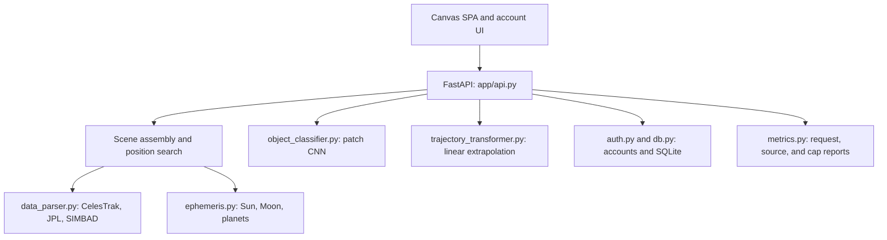

# Architecture

Cosmic Forecast is a FastAPI application with a canvas sky map, catalog-backed
scenes, image classification demos, and trajectory extrapolation. A separate
Python pipeline supports image-patch classification, tracking, learned motion
prediction, and Kalman refinement. The web forecast endpoint currently uses
linear extrapolation rather than that full pipeline.

## Runtime structure



[`api.py`](../app/api.py) serves the frontend and API routes. It also contains
scene projection, TLE propagation, search filtering, cache management, and
catalog orchestration. [`config.py`](../app/config.py) defines per-kind scene
caps, overridable through `COSMIC_CAP_<KIND>`.

## Scene request flow

1. `/api/scene` checks the cache using `datetime_str`, `limit`, `ra`, `dec`, and
   `radius_deg`. A hit returns the assembled scene, including its warnings.
2. On a miss, the route validates inputs and resolves the requested datetime.
   An omitted datetime means now; a datetime without a timezone is treated as UTC.
3. `_capped_scene_objects` fetches CelesTrak, JPL, and SIMBAD kinds concurrently
   using a thread pool. Source results carry objects, cap counts, and optional
   failure metadata. `limit` overrides the satellite cap only.
4. Local Earth, Sun, Moon, and planet objects are added.
5. Optional position search uses great-circle separation in RA/Dec. Objects
   without usable coordinates are excluded; Earth remains as the observer.
6. The route returns `datetime`, `objects`, `source_warnings`, `source_freshness`, optional `valid_until`, and an optional
   `search` summary, then caches the response. Cap outcomes feed admin metrics.

The frontend merges the signed-in user's custom objects after loading the scene.

### Catalogs and positions

| Source | Query and scene behavior |
| --- | --- |
| CelesTrak | GP queries with explicit `FORMAT=tle`; sgp4 propagates elements to the requested datetime. `iss` uses `stations`; debris can select Cosmos 2251, Iridium 33, Fengyun 1C, or their deduplicated union; rocket bodies use `NAME=R/B`. Satellites try `active`, `starlink`, then `last-30-days`. |
| JPL CAD | Near-Earth approaches from the requested date through 30 days later. Approach distance is real; displayed direction is a deterministic placeholder. |
| SIMBAD | TAP/ADQL queries by object type. Positions use catalog RA/Dec; deep-space distance is represented by an outer display band. |
| Local ephemeris | Approximate Sun, Moon, and planet coordinates from `app/ephemeris.py`; no external request per scene. |

The map uses right ascension as angle and log geocentric distance as radius.
This is a compressed visualization, not a literal sky chart: declination is
mostly collapsed, and visual proximity does not imply physical proximity.
SIMBAD coordinates are catalog-based; the JPL placeholder direction is not.

The scene's `_DEEP_SPACE_KINDS` currently includes galaxy, nebula, star, black
hole, quasar, pulsar, and supernova remnant. The parser supports additional
slugs, including star clusters and variable stars, which are not automatically
included in scene assembly. [`object_classes.py`](../app/object_classes.py)
defines the class registry; `get_data` in
[`data_parser.py`](../app/data_parser.py) routes single-catalog requests.

### Caching and failures

| Layer | Key | Reuse and storage |
| --- | --- | --- |
| Scene | Raw datetime, limit, RA, Dec, radius | 45 seconds (30 for failures); process-local dictionary, maximum 64 entries; expiry pruning and oldest-entry eviction on insertion. |
| SIMBAD catalog | Source, kind, cap | 6 hours on success, 30 seconds on failure; shared 256-entry process-local catalog cache. |
| JPL catalog | Source, requested date, cap | 1 hour on success, 30 seconds on failure; same catalog cache. |
| TLE | Object slug | Disk text under `COSMIC_TLE_CACHE_DIR` (default `data/tle_cache`); refresh after 2 hours; 30-second failed-refresh retry; 24-hour maximum download age. |

Catalog entries are bounded and expired entries pruned on access. Per-key locks
share concurrent misses; dictionary locks protect mutations without holding a
global lock during upstream requests. Scene requests for the same key also
share assembly work. Locks/caches are process-local, not shared across workers.

TLE responses are structurally/numerically validated before atomic replacement.
A memory cache avoids rereading/revalidating unchanged disk files. Refresh
failures may use downloads less than 24 hours old, with freshness metadata;
scene reuse cannot exceed that deadline. Element epochs can be older than the
download, so the UI separately warns about elements older than 7 days.
Scene hits reuse positions; rebuilds propagate available elements without
making them newer. The UI displays the returned scene timestamp.

Scene fetch exceptions pass through `_source_unavailable`, which logs details,
updates `metrics.source_failures`, and returns an empty result with source
metadata. The UI displays a “Map incomplete” notice naming affected kinds and
sources. Warnings survive cached responses and clear on a healthy response.
Raw errors stay in admin reporting. A successful CelesTrak fallback to a smaller
catalog still lacks a coverage
notice; stale-download status is shown separately. See
[`known-issues.md`](known-issues.md).

## Classification and forecasting

### Web request behavior

`_get_cnn` lazily creates a CNN and trains it on a small synthetic dataset on
first classification, retaining the model in process memory. It does not load
a published model artifact. `/api/classify/{id}` generates a patch based on the
requested kind and object ID (or random pixels when the kind is unknown), then
classifies it. This is a demo, not classification of an observed map object.
`/api/classify/upload` classifies the supplied image using the same model.

`/api/forecast` accepts position histories, skips histories shorter than two
points, and returns 50 linear-extrapolation waypoints per remaining object.
The CSV upload flow also uses linear extrapolation.

### Python pipeline (`app/pipeline.py`)

`ForecastPipeline` is a separate reusable composition:

```text
Patch CNN -> Track Builder -> Transformer or linear fallback -> Kalman refinement
```

| Stage | Module | Responsibility |
| --- | --- | --- |
| Patch classification | [object_classifier.py](../app/object_classifier.py) | Classifies supplied patches using the pipeline's CNN. Construction alone does not train it. |
| Tracking | [track_builder.py](../app/track_builder.py) | Associates detections across frames using nearest-neighbor matching with a distance gate. |
| Forecasting | [trajectory_transformer.py](../app/trajectory_transformer.py) | Uses a supplied trajectory model, or linear extrapolation when none is supplied. |
| Refinement | [kalman_refinement.py](../app/kalman_refinement.py) | Refines a predicted position for a target timestamp. |

Shared types live in [`detections.py`](../app/detections.py). The
`create_default_pipeline` helper constructs a trajectory model and can train
it on synthetic trajectories when requested; callers must distinguish model
construction from training. Training/publishing helpers are separate from the
web runtime. Synthetic training and model-card caveats are described in the
known-issues document.

## API surface

| Method | Path | Purpose |
| --- | --- | --- |
| GET | `/api/scene` | Assemble/filter a scene with source warnings. |
| GET | `/api/objects/{object_slug}` | Fetch one catalog kind; separate from the frontend scene flow. |
| GET | `/api/classify/{obj_id}` | Classify a synthetic patch for a map-object demo. |
| POST | `/api/classify/upload` | Classify an uploaded image. |
| POST | `/api/upload/csv` | Build objects and forecasts from a positions CSV. |
| POST | `/api/forecast` | Linear extrapolation of position histories. |
| POST | `/api/auth/register`, `/api/auth/login`, `/api/auth/logout` | Account/session lifecycle. |
| GET | `/api/auth/me` | Current account. |
| PUT | `/api/preferences` | Save account preferences. |
| GET, POST | `/api/searches`, `/api/uploads`, `/api/custom-objects` | List/create owned records. |
| DELETE | `/api/searches/{search_id}`, `/api/uploads/{upload_id}`, `/api/custom-objects/{object_id}` | Delete an owned record. |
| GET | `/api/admin/health` | Admin-only request metrics, source failures, and scene-cap reporting. |

Page routes are `/`, `/help`, `/profile`, and `/admin`. Static assets are served
under `/static`; FastAPI's interactive API reference is at `/docs`.

## Accounts and persistence

[`auth.py`](../app/auth.py) handles PBKDF2 password hashing, bearer sessions,
and current-user dependencies. Only the SHA-256 hash of a session token is
stored. Sessions expire after seven days; logout invalidates the token.

[`db.py`](../app/db.py) stores `users`, `sessions`, `saved_searches`,
`saved_uploads`, and `custom_objects` in SQLite. Theme/admin fields live on the
user row. `COSMIC_DB_PATH` selects the database (default `data/cosmic.db`).
Application operations reuse one SQLite connection per worker thread. Failed
operations roll back before that connection is reused; changing
`COSMIC_DB_PATH` closes and replaces the thread's connection. Caller-owned
connections remain available through `get_conn()` for explicit SQL work. File
databases use WAL and a 5-second busy timeout. Owned tables have user indexes.

`COSMIC_ADMIN_USERS` identifies admins at registration. When
`COSMIC_BOOTSTRAP_ADMIN` is enabled, `COSMIC_BOOTSTRAP_ADMIN_PASSWORD` is
required and must contain at least 12 characters; the optional username defaults
to `admin`. Startup creates that account or rotates an existing account's
credentials and grants admin status. No built-in password exists.

## Frontend

The browser runtime is a canvas SPA in [`app.js`](../front_end/static/app.js),
with [`auth.js`](../front_end/static/auth.js) supplying account interactions.
It handles scene loading, a source-availability notice, pan/zoom, kind filters,
position search, simulation, themes, image/CSV uploads, and custom objects.
Sun/Moon artwork and body lighting are synchronized with scene geometry. Theme
motifs are decorative; opt-in near-pass flashes use projected proximity, not
conjunction analysis. Browser runtime code has no package dependencies;
frontend tests use Jest and jsdom.

## Adding a scene kind

1. Add its class to [`object_classes.py`](../app/object_classes.py).
2. Add parser routing: `_SIMBAD_OTYPES` for SIMBAD, or an appropriate fetcher
   and mapping for another source in `data_parser.py`.
3. Include the kind in the relevant scene-kind list in `api.py` and wire a
   fetcher if needed. Provide coordinates and source metadata consistently.
4. Add a default cap in `config.py`; an unknown kind otherwise defaults to zero.
5. Add `KIND_STYLES` and `KIND_NAMES` in `app.js`, plus relevant help/filter
   metadata. Decide whether animation/motifs apply.
6. Test registry/routing, scene inclusion, caps, warnings, and frontend display.

Changing the classifier's class registry changes output dimensions and requires
compatible retraining/artifacts. Catalog placement is independent of CNN output.

## Testing and tooling

- Backend coverage gate: `uv run pytest --cov=. --cov-fail-under=80`.
- Frontend: from `front_end`, run `npm test` (Jest/jsdom); it installs locked
  tools in a temporary directory to avoid cloud-synced dependency folders.
  Conventional local installs can use `npm ci` and `npm run test:local`.
  On Windows PowerShell with script execution disabled, use `npm.cmd`.
- Style: Black and flake8 through the repository's pre-commit configuration.
- Scripts support module invocation from the repo root and direct file
  invocation from any directory using the project's Python interpreter.
  Default model/archive paths are anchored to the checkout; explicit relative
  input/output paths remain relative to the caller. Publishing supports `--root`.

CI runs backend checks on Linux, Windows, and Intel macOS, and a separate
frontend job performs a clean lockfile install. See [environment setup](environment.md).

Coverage percentages and completed checks belong in test/PR results rather than
this architecture reference. See [README](../README.md) for startup instructions
and [known issues](known-issues.md) for prioritized limitations.
